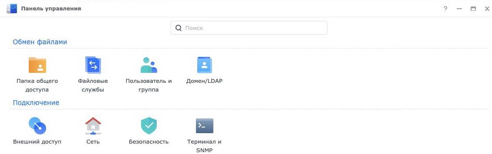
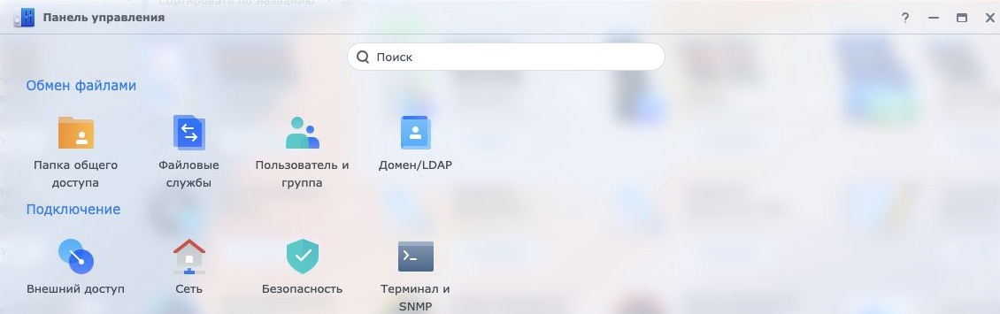
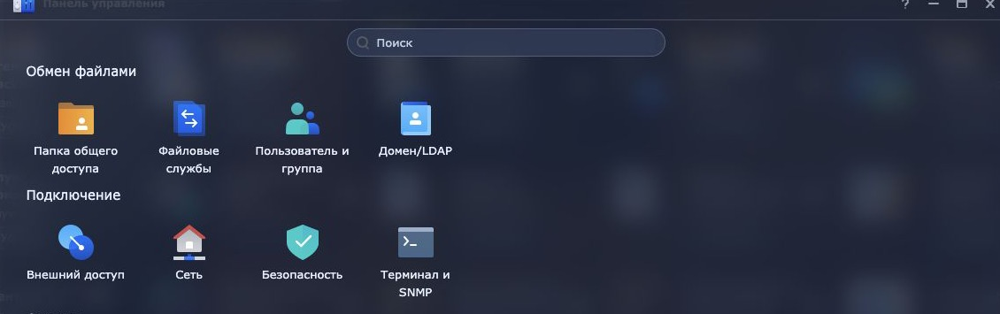

# DSM Liquid Glass

[Русское руководство](README.md)

A theme for Synology DSM’s desktop and mobile web interfaces. On the desktop, windows, menus and notifications pick up the wallpaper colours, while a ripple gently distorts the wallpaper itself. The mobile interface has its own palette for lists, headers and bottom navigation.

## Before and after

The same Control Panel with the same wallpaper. The first image shows DSM with the theme stylesheet disabled. The next two show Light and Dark. Open an image at full size to compare the window surface and search field.

| DSM | Liquid Glass · Light | Liquid Glass · Dark |
|---|---|---|
|  |  |  |

## Compatibility

Tested on **DSM 7.4.1-90080 Update 1**. The installer accepts build 90080. Desktop checks covered Control Panel, File Station and Package Center. The mobile menu and Package Center were checked in Chromium at 390 px with an iPhone user agent. Third-party apps that render their own interface may use their own colours.

## Install over SSH

Connect to the NAS as a DSM administrator. The command downloads the v1.0.1 installer and runs it with sudo. You need access to raw.githubusercontent.com, a mounted /volume1, curl and sha256sum. Existing gzip or Brotli copies require gzip or brotli, respectively.

```sh
(f=$(mktemp) && trap 'rm -f "$f"' EXIT && curl -fsSL https://raw.githubusercontent.com/konstpic/dsm-liquid-glass/v1.0.1/setup.sh -o "$f" && sudo sh "$f" install)
```

Hard-refresh DSM after installation. In **Control Panel**, open **Темы** (Themes). The theme picker uses Russian labels. Choose **Светлая** (Light), **Тёмная** (Dark) or **Авто** (follow the device). The preference is saved in this browser for this NAS address. The mobile web interface shares that browser preference. Wallpaper animation respects the device’s reduced-motion setting.

## Update the installed theme

The updater resolves the latest published release, verifies the files and updates both interfaces. The original DSM bundles are retained for offline removal.

```sh
sudo sh /volume1/@dsm-liquid-glass/setup.sh update
```

When upgrading from v1.0.0, download the new installer once and run it with the update argument.

```sh
(f=$(mktemp) && trap 'rm -f "$f"' EXIT && curl -fsSL https://raw.githubusercontent.com/konstpic/dsm-liquid-glass/v1.0.1/setup.sh -o "$f" && sudo sh "$f" update)
```

## Uninstall over SSH

```sh
sudo sh /volume1/@dsm-liquid-glass/setup.sh uninstall
```

This command works offline and restores the original mobile and desktop files. Reload DSM after it completes.

## Installation and recovery

The installer verifies the SHA-256 checksums of install.sh, themes.js and mobile.js. It appends the theme to DSM’s two JavaScript bundles and rebuilds any existing compressed copies. Originals are kept in /volume1/@dsm-local-themes and /volume1/@dsm-local-mobile-themes. The offline removal tools remain in /volume1/@dsm-liquid-glass. Running the installer again skips an interface that already carries the patch marker.

Remove the theme before a DSM upgrade, then check the new build for compatibility. If a bundle’s checksum has changed, removal stops to protect the changed system file. Preserve the original backups and check your DSM build before recovering manually. If installation succeeds but the page looks unchanged, try a private browser window to rule out a stale cache.
