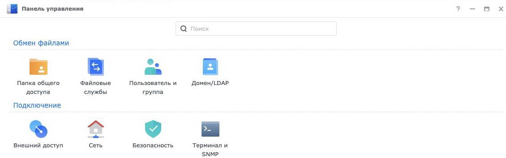
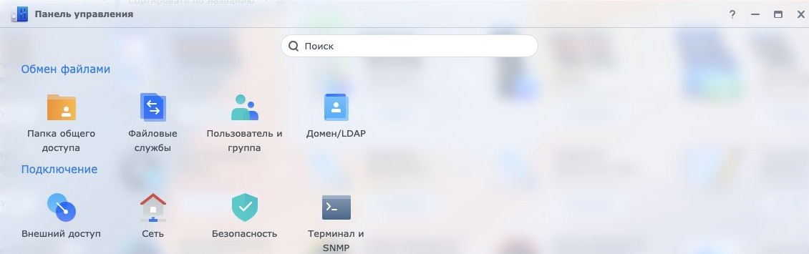
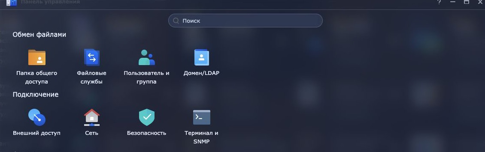

# DSM Liquid Glass

[English guide](README.en.md)

Тема для веб-интерфейсов Synology DSM. На рабочем столе окна, меню и уведомления пропускают цвет обоев, а по самим обоям расходятся волны. В мобильном интерфейсе отдельная палитра для списков, заголовков и нижней навигации.

## До и после

Одна и та же Панель управления с тем же фоном. Слева стили патча отключены, в центре светлая тема, справа тёмная. Откройте изображение в полном размере, чтобы сравнить фон окна и поле поиска.

| DSM | Liquid Glass · Light | Liquid Glass · Dark |
|---|---|---|
|  |  |  |

## Совместимость

Проверено на **DSM 7.4.1-90080 Update 1**. Установщик допускает сборку 90080. Проверены Панель управления, File Station и Центр пакетов в настольном браузере. Мобильное меню и Центр пакетов проверены в Chromium с iPhone User-Agent при ширине 390 px. Сторонние приложения со своим интерфейсом могут использовать собственные цвета.

## Установить по SSH

Войдите на NAS по SSH под администратором DSM. Команда скачает установщик версии v1.0.1 и запросит права через sudo. Нужны интернет-доступ к raw.githubusercontent.com, доступный том /volume1, curl и sha256sum. Для уже имеющихся сжатых копий DSM нужны gzip или brotli соответственно.

```sh
(f=$(mktemp) && trap 'rm -f "$f"' EXIT && curl -fsSL https://raw.githubusercontent.com/konstpic/dsm-liquid-glass/v1.0.1/setup.sh -o "$f" && sudo sh "$f" install)
```

После установки перезагрузите вкладку DSM с обновлением кеша. Откройте **Панель управления → Темы** и выберите **Светлая**, **Тёмная** или **Авто**. Выбор хранится в браузере для текущего адреса NAS. «Авто» следует системному оформлению устройства. На телефоне отдельный мобильный интерфейс использует ту же настройку браузера. Анимация обоев учитывает настройку уменьшения движения.

## Обновить установленную тему

Команда находит последний опубликованный релиз, проверяет файлы и обновляет обе версии интерфейса. Оригиналы DSM сохраняются для удаления.

```sh
sudo sh /volume1/@dsm-liquid-glass/setup.sh update
```

Для перехода с v1.0.0 один раз скачайте новый установщик и запустите его с аргументом update.

```sh
(f=$(mktemp) && trap 'rm -f "$f"' EXIT && curl -fsSL https://raw.githubusercontent.com/konstpic/dsm-liquid-glass/v1.0.1/setup.sh -o "$f" && sudo sh "$f" update)
```

## Удалить по SSH

```sh
sudo sh /volume1/@dsm-liquid-glass/setup.sh uninstall
```

Команда работает без интернета. Она восстанавливает оригиналы мобильного и настольного интерфейсов. Перезагрузите вкладку после удаления.

## Как устроена установка

Установщик проверяет SHA-256 загруженных install.sh, themes.js и mobile.js. Затем дописывает стили и код темы в два системных JavaScript-файла DSM и пересобирает существующие сжатые копии. Оригиналы сохраняются в /volume1/@dsm-local-themes и /volume1/@dsm-local-mobile-themes. В /volume1/@dsm-liquid-glass остаются инструменты локального удаления. Повторная установка пропускает уже помеченный интерфейс.

Перед обновлением DSM удалите патч. После обновления проверьте совместимость новой сборки. Если при удалении контрольная сумма отличается, восстановление остановится, чтобы сохранить изменённый системный файл. Сохраните оригиналы из каталогов выше и проверьте версию DSM перед дальнейшим восстановлением. Если после успешной установки внешний вид прежний, откройте DSM в новой приватной вкладке, чтобы исключить кеш браузера.
